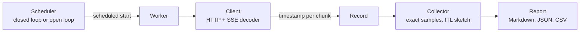

# llm-loadtest

[](https://github.com/aozmekik/llm-loadtest/actions/workflows/ci.yml)
[](LICENSE)

Load-test OpenAI-compatible streaming chat endpoints and measure time to
first token, inter-token latency and throughput, with open-loop arrivals
that do not hide queueing.

Status: early (v0.1.0). Flags, output formats and the Go API may change.

## Why

LLM serving latency is not one number. Time to first token (TTFT) is
dominated by queueing and prefill; inter-token latency (ITL) by decode
batching. They move differently under load, and both matter to users.

Most load generators run a closed loop: N workers, each sending its next
request when the previous one finishes. That answers "how does the server
behave with N streams in flight?", but when the server slows down the
workers slow down with it, so the queueing real users would see is never
measured. This is coordinated omission. llm-loadtest also runs an open
loop, sending requests at scheduled Poisson or constant arrival times and
measuring latency from the scheduled start
([ADR 0001](docs/adr/0001-open-loop-latency-from-scheduled-time.md)).

It is a single self-contained binary with no dependencies beyond the Go
standard library, and it ships with a mock server so a benchmark can be
rehearsed without a GPU.

## Features

- Per request: TTFT, ITL between chunks, time per output token (TPOT),
  end-to-end latency, output and input tokens, output tokens/s.
- Per stage: request and output-token throughput, p50/p90/p95/p99 for every
  metric, error counts by class with a sample message.
- Load models: fixed concurrency, concurrency sweeps (`--concurrency
  1,2,4,8,16,32`), open-loop Poisson or constant arrivals (`--rate 1,2,4`),
  warmup, duration or request-count stages.
- Exact token counts via `stream_options.include_usage`; when the server
  sends no usage, a chunk-count approximation that the report labels as such.
- Synthetic prompts of a target length (exact for the `cl100k_base` and
  `o200k_base` encodings) or JSONL datasets.
- An SSE decoder that follows the WHATWG parsing rules: any chunk
  boundaries, CRLF/LF/CR, comments, multi-line data, `[DONE]`, error
  payloads mid-stream. Fuzz-tested against a reference parser.
- Markdown report, JSON and CSV export, and `compare` with a regression
  threshold for CI.
- `llm-loadtest mock`: an OpenAI-compatible server with latency
  distributions, output lengths, limited slots and error injection.
- The API key is read from an environment variable and never printed or
  saved; header values and URL credentials are scrubbed from error messages.

## Install

Not yet published to any package registry or as release binaries; install
from source with Go 1.26 or later:

```sh
go install github.com/aozmekik/llm-loadtest/cmd/llm-loadtest@latest
```

The reusable packages (`mock` and `sse`, see [As a library](#as-a-library)):

```sh
go get github.com/aozmekik/llm-loadtest
```

Or build from a clone: `go build -o llm-loadtest ./cmd/llm-loadtest`.

## Quick start

Rehearse against the built-in mock (no GPU, no key):

```sh
llm-loadtest mock --slots 8 &          # serves http://127.0.0.1:8000/v1
llm-loadtest run --base-url http://127.0.0.1:8000/v1 --model mock \
  --concurrency 1,4,16 --duration 20s
```

Then point it at a real server. The `--base-url` defaults below are the
ports these projects document; adjust them to your deployment.

| Server | `--base-url` |
|---|---|
| vLLM | `http://localhost:8000/v1` |
| SGLang | `http://localhost:30000/v1` |
| llama.cpp `llama-server` | `http://localhost:8080/v1` |
| Ollama | `http://localhost:11434/v1` |
| OpenAI | `https://api.openai.com/v1` |
| OpenRouter | `https://openrouter.ai/api/v1` |

```sh
# Concurrency sweep with fixed-length output on vLLM (ignore_eos is a vLLM extension).
llm-loadtest run --base-url http://localhost:8000/v1 --model "$MODEL" \
  --input-tokens 512 --max-tokens 256 --extra-body '{"ignore_eos": true}' \
  --concurrency 1,2,4,8,16,32 --duration 60s --warmup 16 \
  --out results.json --out results.csv

# Open-loop Poisson arrivals against a hosted API; the key comes from $OPENAI_API_KEY.
llm-loadtest run --base-url https://api.openai.com/v1 --model "$MODEL" \
  --rate 0.5,1 --duration 2m --max-tokens 128
```

## Usage

`llm-loadtest run -h`, `mock -h` and `compare -h` list every flag.

### Load models

| Flags | Load | Use it to answer |
|---|---|---|
| `--concurrency 8` | closed loop, 8 requests always in flight | How does the server behave with 8 concurrent streams? |
| `--concurrency 1,2,4,8,16` | one closed-loop stage per level | Where does throughput saturate, and what does it cost in latency? |
| `--rate 2 --arrival poisson` | open loop, 2 req/s on average | What latency do users see at 2 req/s, including queueing? |
| `--rate 1,2,4` | one open-loop stage per rate | At what traffic does latency break down? |

Each stage stops issuing after `--duration` (default 30s) or `--requests`,
whichever comes first, then waits for requests in flight. `--warmup N`
sends N requests first and leaves them out of the results; if every warmup
request fails, the run stops before wasting time. Open-loop concurrency is
capped by `--max-in-flight` (default 1024); waiting for the cap is counted
in latency and reported as send lag.

### Prompts

Without `--dataset`, each request gets a distinct synthetic prompt of
`--input-tokens` tokens (default 256), random common words followed by an
instruction to continue. Distinct prompts keep a prefix cache from
flattering TTFT. The text is exactly the target length in `cl100k_base` and
`o200k_base`; other tokenizers and chat templates differ, and the report
shows the server-measured input tokens when usage is available.

A dataset is JSONL with one `prompt` or `messages` per line and an optional
per-row `max_tokens` ([example](examples/prompts.jsonl)):

```json
{"prompt": "Explain the difference between latency and throughput."}
{"messages": [{"role": "system", "content": "Be concise."}, {"role": "user", "content": "What is a load balancer?"}], "max_tokens": 96}
```

Rows are used in order and repeated; `--shuffle` permutes them with
`--seed`.

### Output

- stderr: a progress line per stage (rewritten in place on a terminal).
- stdout: a Markdown report with one summary row per stage and a percentile
  table for each stage.
- `--out file.json|file.csv|file.md` (repeatable): JSON with the
  configuration, aggregates and one record per request
  (`--json-records=false` keeps only aggregates); CSV with one row per
  request; Markdown as on stdout.

Every metric is defined in [docs/metrics.md](docs/metrics.md). In short:
TTFT and E2E are measured from each request's scheduled start, ITL between
consecutive content chunks, TPOT as (E2E - TTFT) / (tokens - 1), and
distributions cover successful requests only.

### Comparing runs

```sh
llm-loadtest compare base.json head.json --threshold 10
```

Stages are matched by load. The table shows each key metric and its
relative change (percentage points for error rate). With `--threshold`,
any metric worse by more than that many percent is marked as a regression
and the exit code is 1, which makes it usable as a CI gate.

### Exit codes

| Code | Meaning |
|---|---|
| 0 | Success. |
| 1 | The run failed, no request succeeded, or `compare` found a regression. |
| 2 | Invalid flags or arguments. |
| 130 | Interrupted by Ctrl-C or SIGTERM; partial results were still written. |

### Mock server

```sh
llm-loadtest mock --ttft normal:150ms,30ms --itl normal:20ms,4ms \
  --output-tokens uniform:64,256 --slots 8 --error-rate 0.01 --abort-rate 0.005
```

Distributions are `50ms` (constant), `uniform:LO,HI`, `normal:MEAN,STDDEV`
or `exp:MEAN`. `--slots` limits concurrent generations so that extra
requests queue and their wait shows up as TTFT, which makes saturation
visible in a sweep. Faults: `--error-rate` (HTTP `--error-status`),
`--stream-error-rate` (error payload mid-stream) and `--abort-rate`
(dropped connection). `--no-usage` imitates servers without usage
reporting, `--tokens-per-chunk` servers that batch output.

### As a library

The `mock` and `sse` packages are public. The mock is an `http.Handler`, so
it works with `httptest` in your own tests:

```go
srv, _ := mock.New(mock.Config{
	TTFT:         mock.Normal(80*time.Millisecond, 10*time.Millisecond),
	ITL:          mock.Constant(15 * time.Millisecond),
	OutputTokens: mock.Uniform(32, 128),
})
ts := httptest.NewServer(srv) // point any OpenAI client at ts.URL + "/v1"
defer ts.Close()

dec := sse.NewDecoder(resp.Body) // resp: a streaming response
for {
	ev, err := dec.Next() // io.EOF at the end of the stream
	if err != nil {
		break
	}
	fmt.Println(ev.Type, ev.Data)
}
```

[examples/library](examples/library/main.go) is a complete program
(`go run ./examples/library`); the packages' godoc has runnable examples.

## Design



- **Latency from the scheduled start.** Open-loop arrival times come from
  the seeded schedule alone, never from response times, and latency is
  measured from them, so neither a slow server nor a lagging generator can
  hide queueing. [ADR 0001](docs/adr/0001-open-loop-latency-from-scheduled-time.md)
- **Exact where cheap, a sketch where not.** Per-request metrics keep every
  sample. ITL produces a sample per token and goes into a DDSketch with 1%
  relative accuracy and bounded memory.
  [ADR 0002](docs/adr/0002-ddsketch-for-inter-token-latency.md)
- **No dependencies in the timing path, or anywhere.** The SSE decoder is
  written from the WHATWG specification and dispatches an event as soon as
  its last line is read, without lookahead. Response compression is
  disabled because a decompressor buffers chunks.
  [ADR 0003](docs/adr/0003-standard-library-only.md)
- **Deterministic timing tests.** The scheduler, client and mock run inside
  `testing/synctest` bubbles, connected by an in-memory transport, so tests
  assert exact durations instead of tolerances.
  [ADR 0004](docs/adr/0004-deterministic-timing-tests.md)

Trade-offs: ITL is measured per chunk, so servers that batch tokens into
chunks report chunk cadence (TPOT stays per token). Duration-bound stages
include the drain of requests in flight, which slightly lowers throughput
for long requests. Past saturation, open-loop latency keeps growing for the
length of the stage, by design; compare runs of equal duration.

## Benchmarks

All numbers below come from the built-in **mock server**, not from a
model. They show what the tool measures and how much overhead it adds; for
real-engine numbers, bring your own server.

Environment for every run: Apple M1 Pro (8 cores), 16 GB RAM, macOS 26.6.2,
Go 1.27.2, client and mock on the same machine over loopback, binary built
from commit `bed18bf`. Other jobs were running on the machine throughout
(load average 17 to 29), so expect noise, especially in the tails.

### Measurement overhead

A mock with constant 50 ms TTFT, 10 ms ITL and 64 output tokens, so the
expected E2E is 50 + 63 x 10 = 680 ms:

```sh
llm-loadtest mock --addr 127.0.0.1:18300 --ttft 50ms --itl 10ms --output-tokens 64
llm-loadtest run --base-url http://127.0.0.1:18300/v1 --model mock --max-tokens 64 \
  --concurrency 1,8,32 --duration 20s --warmup 8
```

| Concurrency | Requests | TTFT p50 | TTFT p99 | ITL p50 | TPOT p50 | E2E p50 | E2E p99 |
|--:|--:|--:|--:|--:|--:|--:|--:|
| 1 | 30 | 51.4 ms | 53.7 ms | 10.1 ms | 10.0 ms | 681 ms | 686 ms |
| 8 | 240 | 51.4 ms | 51.7 ms | 10.1 ms | 10.0 ms | 681 ms | 682 ms |
| 32 | 960 | 50.9 ms | 52.1 ms | 10.1 ms | 10.0 ms | 682 ms | 683 ms |

Measured TTFT is 0.9 to 1.4 ms above the configured value, which covers the
mock's timer, the loopback round trip and the client. ITL p50 reads 10.1 ms,
within the sketch's 1% accuracy of the configured 10 ms; the exact mean ITL
and TPOT p50 read 10.0 ms.

### Generator ceiling

A mock with zero latency and 64 output tokens, so the client and the mock,
sharing the same CPUs, are the bottleneck:

```sh
llm-loadtest mock --addr 127.0.0.1:18301 --ttft 0s --itl 0s --output-tokens 64
llm-loadtest run --base-url http://127.0.0.1:18301/v1 --model mock --max-tokens 64 \
  --concurrency 1,16,64 --duration 10s --warmup 16 --json-records=false
```

| Concurrency | Requests | Req/s | Output tok/s | E2E p50 | E2E p99 |
|--:|--:|--:|--:|--:|--:|
| 1 | 19,826 | 1,983 | 126,886 | 0.49 ms | 0.85 ms |
| 16 | 54,545 | 5,453 | 349,011 | 2.17 ms | 13.0 ms |
| 64 | 54,096 | 5,404 | 345,853 | 4.31 ms | 64.5 ms |

Throughput flattens at about 5,400 req/s on this shared machine. Real
servers are orders of magnitude slower per request, so the generator is
unlikely to be the limit; if send lag grows in an open-loop run, it is.

### Saturation and coordinated omission

From [examples/demo.sh](examples/demo.sh) with `DURATION=20s`: a mock with
8 slots where each request takes about 2 s (120 ms TTFT, 15 ms per token,
64 to 192 tokens), so its capacity is about 4 req/s.

Closed-loop sweep (`--concurrency 1,2,4,8,16 --duration 20s --warmup 8`):

| Load | OK | Req/s | Out tok/s | TTFT p50 | TTFT p99 | ITL p50 | E2E p50 | E2E p99 |
|:--|--:|--:|--:|--:|--:|--:|--:|--:|
| concurrency=1 | 10 | 0.50 | 62.6 | 115 | 147 | 15.3 | 1909 | 2781 |
| concurrency=2 | 23 | 1.12 | 125 | 117 | 159 | 15.0 | 1696 | 2768 |
| concurrency=4 | 43 | 2.00 | 244 | 122 | 163 | 15.0 | 1883 | 2976 |
| concurrency=8 | 87 | 3.95 | 494 | 120 | 164 | 15.0 | 2086 | 2978 |
| concurrency=16 | 92 | 3.78 | 477 | 2071 | 2710 | 15.0 | 3939 | 4936 |

Throughput saturates at 8 streams; at 16 the extra requests wait for a
slot and TTFT jumps from 120 ms to 2 s. Running the same sweep against a
mock with 16 slots and comparing (`llm-loadtest compare`) shows the
concurrency=16 stage improving by +101.4% in req/s and -94.3% in TTFT p50.

Open loop at Poisson rates below and above capacity (`--rate 2,6
--duration 20s`, prompts from `examples/prompts.jsonl`):

| Load | OK | Req/s | TTFT p50 | TTFT p99 | E2E p50 | E2E p99 |
|:--|--:|--:|--:|--:|--:|--:|
| rate=2/s poisson | 45 | 2.05 | 118 | 158 | 1521 | 2821 |
| rate=6/s poisson | 127 | 4.16 | 5263 | 9042 | 7460 | 11279 |

Latencies in ms. The closed loop at concurrency 8 reported a TTFT p99 of
164 ms at 3.95 req/s. Offered 6 req/s, the same server completes about
4 req/s and the queue grows for the whole stage: TTFT p50 is 5.3 s. A
closed loop cannot show this, because it never offers more than the server
completes.

### Microbenchmarks

```sh
go test -run='^$' -bench=. -benchtime=2s -count=3 ./sse ./internal/stats
```

| Benchmark | Result | Allocations |
|---|---|---|
| SSE decoder, 1,001 OpenAI-style events (157 KiB) | 0.72 to 1.15 GB/s | 1,004 allocs per stream |
| DDSketch `Add` | 15 to 31 ns per value | 0 |

The ranges span two runs of three, at load averages of about 17 and 23
(the `sse` and `internal/stats` code was the same in both); the slow ends
come from the busier run.

## Testing

`go test -race -shuffle=on ./...` runs 95 test functions, 2 runnable
examples, a fuzz target and 2 benchmarks. They include SSE parsing of
fragmented input and a fuzz test against a reference parser, percentile and
sketch accuracy checks against known values, exact end-to-end timing of
client and mock inside `testing/synctest` bubbles, the open-loop scheduler
on the fake clock, and a coordinated-omission test. Statement coverage is
93.2% for the module (92.5% to 99.0% per library package), from
`go test -coverprofile=cover.out ./... && go tool cover -func=cover.out`.
See [CONTRIBUTING.md](CONTRIBUTING.md) for all commands.

## Limitations

- Only `/v1/chat/completions` with `stream: true`. No legacy completions,
  embeddings, multimodal inputs or tool-call workloads.
- One process generates the load; there is no distributed mode.
- ITL is per chunk (see [Design](#design)); TTFT counts reasoning tokens as
  output.
- Synthetic prompt length is exact only for `cl100k_base` and `o200k_base`.
- No custom TLS settings (client certificates, custom CAs) beyond the
  system trust store and `HTTPS_PROXY`.
- Tested against the built-in mock and hand-written protocol fixtures only;
  it has not yet been run against vLLM, SGLang, llama.cpp, Ollama or hosted
  APIs in this repository. Reports of mismatches are welcome.
- CI covers Linux and macOS; Windows builds are cross-compiled but not
  tested.

## Roadmap

- Goodput: the share of requests meeting TTFT and TPOT objectives.
- Ramp and step load patterns, and arrival bursts.
- Prompt-length and output-length distributions, and importers for public
  datasets such as ShareGPT.
- Re-aggregating ITL across result files by storing sketches in the JSON.
- Release binaries via the included `.goreleaser.yaml`.

## References and inspiration

Implemented from these specifications and papers:

- WHATWG HTML Living Standard, section 9.2 "Server-sent events":
  https://html.spec.whatwg.org/multipage/server-sent-events.html
- OpenAI API reference, chat completions streaming and
  `stream_options`: https://platform.openai.com/docs/api-reference/chat
- Masson, Rim and Lee, "DDSketch: A Fast and Fully-Mergeable Quantile
  Sketch with Relative-Error Guarantees", VLDB 2019.
- Gil Tene, "How NOT to Measure Latency", 2015, on coordinated omission;
  wrk2's correction for it.
- Hyndman and Fan, "Sample Quantiles in Statistical Packages", 1996.

The metric set follows what serving benchmarks such as vLLM's
`benchmark_serving`, Ray's LLMPerf and NVIDIA GenAI-Perf report. No code
was taken from them.

## Contributing

See [CONTRIBUTING.md](CONTRIBUTING.md). Design changes start with an ADR in
[docs/adr](docs/adr).

## License

[MIT](LICENSE)

Built by [Ahmed Semih Özmekik](https://github.com/aozmekik) at [Fergani](https://fergani.tr).
