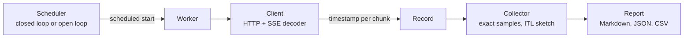

# llm-loadtest

[](https://github.com/aozmekik/llm-loadtest/actions/workflows/ci.yml)
[](LICENSE)

Load-test OpenAI-compatible streaming chat endpoints and measure time to
first token, inter-token latency and throughput, with open-loop arrivals
that do not hide queueing.

Status: early (v0.1.0). Flags, output formats and the Go API may change.

## Why

LLM serving latency is not one number. Time to first token (TTFT) is
dominated by queueing and prefill; inter-token latency (ITL) by decode
batching. They move differently under load, and both matter to users.

A closed loop (N workers, each sending its next request when the previous
one finishes) is the common default. It answers "how does the server
behave with N streams in flight?", but when the server slows down the
workers slow down with it, so the queueing real users would see is never
measured. This is coordinated omission. Open-loop modes, which send at a
target rate, fix that, but they usually time each request from when it was
actually sent, so a generator that falls behind hides the delay again.
llm-loadtest times every request from its *scheduled* start and reports
the generator's send lag separately
([ADR 0001](docs/adr/0001-open-loop-latency-from-scheduled-time.md)).

It is a single self-contained binary with no dependencies beyond the Go
standard library, and it ships with a mock server so a benchmark can be
rehearsed without a GPU.

## Features

- Per request: TTFT, ITL between chunks, time per output token (TPOT),
  end-to-end latency, output and input tokens, output tokens/s.
- Per stage: request and output-token throughput, p50/p90/p95/p99 for every
  metric, error counts by class with a sample message.
- Load models: fixed concurrency, concurrency sweeps (`--concurrency
  1,2,4,8,16,32`), open-loop Poisson or constant arrivals (`--rate 1,2,4`),
  warmup, duration or request-count stages.
- Exact token counts via `stream_options.include_usage`; when the server
  sends no usage, a chunk-count approximation that the report labels as such.
- Synthetic prompts of a target length (exact for the `cl100k_base` and
  `o200k_base` encodings, checked in CI with tiktoken) or JSONL datasets.
- A streaming SSE decoder (the public `sse` package) that follows the
  WHATWG parsing rules: any chunk boundaries, CRLF/LF/CR, comments,
  multi-line data, and no lookahead past the end of an event. Fuzz-tested
  against a reference parser.
- An OpenAI streaming layer on top of it: `[DONE]`, error payloads
  mid-stream, usage chunks, role-only chunks, and servers that omit
  `[DONE]` after a `finish_reason`.
- Markdown report, JSON and CSV export, and `compare` with regression
  thresholds that can gate CI.
- `llm-loadtest mock`: an OpenAI-compatible server with latency
  distributions, output lengths, limited slots and error injection.
- Credentials go only where they are pointed: the API key comes from an
  environment variable and is never printed or saved, `OPENAI_API_KEY` is
  sent only to `api.openai.com`, redirects are not followed, and configured
  secrets are scrubbed from error messages.

## Install

Not yet published to any package registry or as release binaries; install
from source with Go 1.26 or later:

```sh
go install github.com/aozmekik/llm-loadtest/cmd/llm-loadtest@latest
```

The reusable packages (`mock` and `sse`, see [As a library](#as-a-library)):

```sh
go get github.com/aozmekik/llm-loadtest
```

Or build from a clone: `go build -o llm-loadtest ./cmd/llm-loadtest`.

## Quick start

Rehearse against the built-in mock (no GPU, no key). This took 36 s on the
Apple M1 Pro described under [Benchmarks](#benchmarks):

```sh
llm-loadtest mock --slots 8 &          # serves http://127.0.0.1:8000/v1
llm-loadtest run --base-url http://127.0.0.1:8000/v1 --model mock \
  --max-tokens 64 --concurrency 1,4,16 --duration 10s
kill %1                                # stop the mock
```

The mock serves 8 requests at a time, so at concurrency 16 the report shows
requests queueing for a slot: in that run, TTFT p50 went from 150 ms at
concurrency 4 to 1.57 s at 16.

Then point it at a real server. The `--base-url` defaults below are the
ports these projects document; adjust them to your deployment.

| Server | `--base-url` | API key |
|---|---|---|
| vLLM | `http://localhost:8000/v1` | `--api-key-env NAME` if started with `--api-key` |
| SGLang | `http://localhost:30000/v1` | as vLLM |
| llama.cpp `llama-server` | `http://localhost:8080/v1` | as vLLM |
| Ollama | `http://localhost:11434/v1` | none |
| OpenAI | `https://api.openai.com/v1` | `$OPENAI_API_KEY`, read by default |
| OpenRouter | `https://openrouter.ai/api/v1` | `--api-key-env OPENROUTER_API_KEY` |

```sh
# Concurrency sweep with fixed-length output on vLLM (ignore_eos is a vLLM extension).
llm-loadtest run --base-url http://localhost:8000/v1 --model "$MODEL" \
  --input-tokens 512 --max-tokens 256 --extra-body '{"ignore_eos": true}' \
  --concurrency 1,2,4,8,16,32 --duration 60s --warmup 16 \
  --out results.json --out results.csv

# Open-loop Poisson arrivals against OpenAI; the key comes from $OPENAI_API_KEY.
# For o-series models, which do not accept max_tokens, add --max-tokens-field max_completion_tokens.
llm-loadtest run --base-url https://api.openai.com/v1 --model "$MODEL" \
  --rate 0.5,1 --duration 2m --max-tokens 128 --warmup 2
```

`--warmup` sends a few requests first and stops the run if all of them
fail, so a wrong URL, model, key or parameter costs seconds, not the whole
sweep.

## Usage

`llm-loadtest run -h`, `mock -h` and `compare -h` list every flag.

### Load models

| Flags | Load | Use it to answer |
|---|---|---|
| `--concurrency 8` | closed loop, 8 requests always in flight | How does the server behave with 8 concurrent streams? |
| `--concurrency 1,2,4,8,16` | one closed-loop stage per level | Where does throughput saturate, and what does it cost in latency? |
| `--rate 2 --arrival poisson` | open loop, 2 req/s on average | What latency do users see at 2 req/s, including queueing? |
| `--rate 1,2,4` | one open-loop stage per rate | At what traffic does latency break down? |

Each stage stops issuing after `--duration` (default 30s) or `--requests`,
whichever comes first, then waits for requests in flight. `--warmup N`
sends N requests first and leaves them out of the results. Open-loop
concurrency is capped by `--max-in-flight` (default 1024); waiting for the
cap is counted in latency and reported as send lag, and arrivals scheduled
within `--duration` are still sent after it, so a stage whose cap is
saturated runs longer than `--duration` rather than dropping requests.

### Prompts

Without `--dataset`, each request gets a distinct synthetic prompt of
`--input-tokens` tokens (default 256, at least 18): random common words
followed by an instruction to continue. The text is exactly the target
length in `cl100k_base` and `o200k_base`
([scripts/prompttokens](scripts/prompttokens) counts 5,500 prompts with
tiktoken 0.14.0, all exact); other tokenizers and chat templates differ, and
the report shows the server-measured input tokens when usage is available.

Distinct prompts keep a prefix cache from flattering TTFT within a run.
Across runs, the same `--seed` (default 1) sends the same prompts, so a
second run against a server with automatic prefix caching, such as vLLM or
SGLang, can be served from the cache. Give each run against one server its
own `--seed`, or restart the server or reset its cache in between;
`compare` warns when both runs sent the same prompts to the same URL.

A dataset is JSONL with one `prompt` or `messages` per line and an optional
per-row `max_tokens` ([example](examples/prompts.jsonl)):

```json
{"prompt": "Explain the difference between latency and throughput."}
{"messages": [{"role": "system", "content": "Be concise."}, {"role": "user", "content": "What is a load balancer?"}], "max_tokens": 96}
```

Rows are used in order and repeated; `--shuffle` permutes them with
`--seed`. A run that cycles through a dataset says so, since repeated
prompts are also prefix-cache hits.

### API keys and secrets

The key is read from the environment variable named by `--api-key-env` and
sent as `Authorization: Bearer <key>` to `--base-url`. Without the flag,
`OPENAI_API_KEY` is read only when the host is `api.openai.com`, so an
OpenAI key in your environment never reaches the mock, a local engine or a
third-party API by accident. The run prints which variable's key goes to
which host, notes when a remote server gets no key, and warns when the key
would cross the network over plain HTTP
([ADR 0005](docs/adr/0005-credentials-go-only-where-pointed.md)).

The key is never printed or written to a result file. Results store the
base URL with credentials and query values replaced, and only the names of
`--header` headers. Error messages, which servers sometimes fill with the
request they received, are scrubbed of the API key and URL password, and of
header values, URL usernames and query values of 8 bytes or more, also in
their URL-escaped forms. A server that echoes only part of a secret is not
caught.

### Output

- stderr: a progress line per stage (rewritten in place on a terminal).
- stdout: a Markdown report with one summary row per stage and a percentile
  table for each stage.
- `--out file.json|file.csv|file.md` (repeatable): JSON with the
  configuration, aggregates and one record per request
  (`--json-records=false` keeps only aggregates); CSV with one row per
  request; Markdown as on stdout.

Every metric is defined in [docs/metrics.md](docs/metrics.md). In short:
TTFT and E2E are measured from each request's scheduled start, ITL between
consecutive content chunks, TPOT as (E2E - TTFT) / (tokens - 1), and
distributions cover successful requests only. That last point means
timeouts censor the tail: requests that hit `--timeout` (default 5m) are
errors, not part of the percentiles, and the report says so whenever a
stage had any.

### Comparing runs

```sh
llm-loadtest compare base.json head.json --threshold 10 --error-threshold 1
```

Stages are matched by load. The table shows each key metric and its
relative change (percentage points for the error rate); a statistic with no
samples on one side, such as the latency of a stage where every request
failed, shows `-` and is not judged.

With `--threshold PCT`, compare exits 1 when any throughput or latency
metric is more than PCT percent worse, when the error rate rises by more
than `--error-threshold` percentage points (default: the same number), and
also when the comparison does not cover the base run: a base stage is
missing from head, no stage matches, a head stage has no successful
request, or either run was interrupted. The reasons go to stderr, so it
can gate CI. Settings that differ between the runs (model, prompts,
max_tokens, stage duration and so on) are listed but never fail the
comparison. Open-loop results depend on the stage duration once the server
saturates, so compare runs of equal duration.

### Exit codes

| Code | Meaning |
|---|---|
| 0 | Success. |
| 1 | The run failed, no request succeeded, or `compare --threshold` failed. |
| 2 | Invalid flags or arguments. |
| 130 | Interrupted by Ctrl-C or SIGTERM. If a stage had started, the partial results are still printed and written; requests canceled in flight are counted separately, not as errors. |

### Mock server

```sh
llm-loadtest mock --ttft normal:150ms,30ms --itl normal:20ms,4ms \
  --output-tokens uniform:64,256 --slots 8 --error-rate 0.01 --abort-rate 0.005
```

Distributions are `50ms` (constant), `uniform:LO,HI`, `normal:MEAN,STDDEV`
or `exp:MEAN`. `--slots` limits concurrent generations so that extra
requests queue and their wait shows up as TTFT, which makes saturation
visible in a sweep. Faults: `--error-rate` (HTTP `--error-status`),
`--stream-error-rate` (error payload mid-stream) and `--abort-rate`
(dropped connection). `--no-usage` imitates servers without usage
reporting, `--tokens-per-chunk` servers that batch output. Token times are
fixed when generation starts, so on a loaded machine late timers are
caught up: the mean ITL holds, individual gaps can be shorter or longer.

### As a library

The `mock` and `sse` packages are public. The mock is an `http.Handler`, so
it works with `httptest` in your own tests:

```go
srv, _ := mock.New(mock.Config{
	TTFT:         mock.Normal(80*time.Millisecond, 10*time.Millisecond),
	ITL:          mock.Constant(15 * time.Millisecond),
	OutputTokens: mock.Uniform(32, 128),
})
ts := httptest.NewServer(srv) // point any OpenAI client at ts.URL + "/v1"
defer ts.Close()

dec := sse.NewDecoder(resp.Body) // resp: a streaming response
for {
	ev, err := dec.Next() // io.EOF at the end of the stream
	if err != nil {
		break
	}
	fmt.Println(ev.Type, ev.Data)
}
```

[examples/library](examples/library/main.go) is a complete program
(`go run ./examples/library`); the packages' godoc has runnable examples.

## Design



- **Latency from the scheduled start.** Open-loop arrival times come from
  the seeded schedule alone, never from response times, and latency is
  measured from them, so neither a slow server nor a lagging generator can
  hide queueing. [ADR 0001](docs/adr/0001-open-loop-latency-from-scheduled-time.md)
- **Exact where cheap, a sketch where not.** Per-request metrics keep every
  sample. ITL produces a sample per token and goes into a DDSketch with 1%
  relative accuracy and bounded memory.
  [ADR 0002](docs/adr/0002-ddsketch-for-inter-token-latency.md)
- **No dependencies in the timing path, or anywhere.** The SSE decoder is
  written from the WHATWG specification and dispatches an event as soon as
  its last line is read, without lookahead. Response compression is
  disabled because a decompressor buffers chunks.
  [ADR 0003](docs/adr/0003-standard-library-only.md)
- **Deterministic timing tests.** The scheduler, client and mock run inside
  `testing/synctest` bubbles, connected by an in-memory transport, so tests
  assert exact durations instead of tolerances.
  [ADR 0004](docs/adr/0004-deterministic-timing-tests.md)
- **Credentials only where pointed.** See [API keys and
  secrets](#api-keys-and-secrets) and
  [ADR 0005](docs/adr/0005-credentials-go-only-where-pointed.md).

Trade-offs: ITL is measured per chunk, so servers that batch tokens into
chunks report chunk cadence (TPOT stays per token). Duration-bound stages
include the drain of requests in flight, which slightly lowers throughput
for long requests. Past saturation, open-loop latency keeps growing for the
length of the stage, by design; compare runs of equal duration.
Distributions over successful requests keep fast failures from flattering
latency, at the price of leaving timed-out requests out of the tail.

## Benchmarks

Measured against the built-in **mock server**, not a model, on an Apple M1
Pro (8 cores, 16 GB, macOS 26.6.2, Go 1.27.2) shared with other jobs (load
average 7 to 35). For real-engine numbers, bring your own server.
[docs/benchmarks.md](docs/benchmarks.md) has the methodology, every
command and the generator-ceiling, saturation and microbenchmark results.

Measurement overhead, with a mock of constant 50 ms TTFT, 10 ms ITL and 64
tokens (expected E2E 680 ms):

```sh
llm-loadtest mock --addr 127.0.0.1:18300 --ttft 50ms --itl 10ms --output-tokens 64
llm-loadtest run --base-url http://127.0.0.1:18300/v1 --model mock --max-tokens 64 \
  --concurrency 1,8,32 --duration 20s --warmup 8
```

| Concurrency | Requests | TTFT p50 | ITL p50 | TPOT p50 | E2E p50 | E2E p99 |
|--:|--:|--:|--:|--:|--:|--:|
| 1 | 30 | 51.4 ms | 10.1 ms | 10.0 ms | 681 ms | 682 ms |
| 8 | 240 | 51.3 ms | 10.1 ms | 10.0 ms | 681 ms | 684 ms |
| 32 | 960 | 51.0 ms | 10.1 ms | 10.0 ms | 681 ms | 688 ms |

The client adds 1.0 to 1.4 ms to TTFT, including the mock's timer and the
loopback round trip. In the coordinated-omission demo
([examples/demo.sh](examples/demo.sh), a mock with capacity for about
4 req/s), a closed loop at concurrency 8 reports a TTFT p99 of 164 ms,
while Poisson arrivals at 6 req/s show the queue the closed loop hides:
TTFT p50 5.3 s.

## Testing

`go test -race -shuffle=on ./...` runs 111 test functions, 2 runnable
examples, a fuzz target and 2 benchmarks. They include SSE parsing of
fragmented input and a fuzz test against a reference parser, percentile and
sketch accuracy checks against known values, exact end-to-end timing of
client and mock inside `testing/synctest` bubbles, measured TTFT and ITL
percentiles against random mock latencies within five standard errors, the
open-loop scheduler on the fake clock, and a coordinated-omission test.
Statement coverage is 92.8% for the module (92.5% to 99.0% per package
with tests), from `go test -coverprofile=cover.out ./... && go tool cover
-func=cover.out` (Go 1.27.2, Apple M1 Pro). See
[CONTRIBUTING.md](CONTRIBUTING.md) for all commands.

## Limitations

- Only `/v1/chat/completions` with `stream: true`. No legacy completions,
  embeddings, multimodal inputs or tool-call workloads.
- One process generates the load; there is no distributed mode.
- ITL is per chunk (see [Design](#design)); TTFT counts reasoning tokens as
  output.
- Timed-out requests are left out of the latency distributions (see
  [Output](#output)).
- Synthetic prompt length is exact only for `cl100k_base` and `o200k_base`,
  and at least 18 tokens.
- No custom TLS settings (client certificates, custom CAs) beyond the
  system trust store and `HTTPS_PROXY`, and redirects are never followed.
- Tested against the built-in mock and hand-written protocol fixtures only;
  it has not yet been run against vLLM, SGLang, llama.cpp, Ollama or hosted
  APIs in this repository. Reports of mismatches are welcome.
- CI covers Linux and macOS; Windows builds are cross-compiled but not
  tested.

## Roadmap

- Goodput: the share of requests meeting TTFT and TPOT objectives.
- Ramp and step load patterns, and arrival bursts.
- Prompt-length and output-length distributions, and importers for public
  datasets such as ShareGPT.
- Re-aggregating ITL across result files by storing sketches in the JSON.
- Release binaries via the included `.goreleaser.yaml`.

## References and inspiration

Implemented from these specifications and papers:

- WHATWG HTML Living Standard, section 9.2 "Server-sent events":
  https://html.spec.whatwg.org/multipage/server-sent-events.html
- OpenAI API reference, chat completions streaming, `stream_options` and
  `max_completion_tokens`: https://platform.openai.com/docs/api-reference/chat
  (also published as an OpenAPI document in
  https://github.com/openai/openai-openapi)
- Masson, Rim and Lee, "DDSketch: A Fast and Fully-Mergeable Quantile
  Sketch with Relative-Error Guarantees", VLDB 2019.
- Gil Tene, "How NOT to Measure Latency", 2015, on coordinated omission;
  wrk2's correction for it.
- Hyndman and Fan, "Sample Quantiles in Statistical Packages", 1996.

The metric set follows what serving benchmarks such as vLLM's
`benchmark_serving`, Ray's LLMPerf and NVIDIA GenAI-Perf report. No code
was taken from them.

## Contributing

See [CONTRIBUTING.md](CONTRIBUTING.md). Design changes start with an ADR in
[docs/adr](docs/adr).

## License

[MIT](LICENSE)

Built by [Ahmed Semih Özmekik](https://github.com/aozmekik) at [Fergani](https://fergani.tr).
